# Om Kadam

I build and study tools for spectral imaging, explainable computer vision, and applied machine learning. My projects span image acquisition, restoration, model evaluation, and data analytics.

## Start here

| Project | What to explore |
| --- | --- |
| [GI-Vision XAI](https://github.com/Omkadam01/GI-Vision-XAI) | Visual explanations for gastrointestinal image classification |
| [AI Restoration Studio](https://github.com/Omkadam01/AI-Restoration-Studio) | An application for restoring scanning electron microscopy images |
| [CNN Adversarial Robustness](https://github.com/Omkadam01/cnn-adversarial-robustness-analysis) | A study of how image classifiers behave under adversarial perturbations |
| [Uplift Modeling](https://github.com/Omkadam01/uplift-modeling-marketing-campaign) | An analysis of who is likely to respond because of a campaign |

## Explore my GitHub projects

Expand a category to browse its repositories.

<strong>Computer vision &amp; healthcare</strong> · 8 projects

- [GI-Vision XAI](https://github.com/Omkadam01/GI-Vision-XAI) · Gastrointestinal image classification with visual explanations.
- [Gastro-Vision](https://github.com/Omkadam01/Gastro-vision) · A research prototype for gastrointestinal image analysis.
- [HYPERLUMA](https://github.com/Omkadam01/Hyperluma-Portable-Hyperspectrum-Based-Diabetic-Retinopathy-Detection) · A hyperspectral imaging prototype for diabetic retinopathy research.
- [AI Restoration Studio](https://github.com/Omkadam01/AI-Restoration-Studio) · An interface for restoring scanning electron microscopy images.
- [Deepfake Prediction](https://github.com/Omkadam01/deepfake-prediction) · Team Cadre’s hackathon project exploring deepfake detection.
- [LeafLens XAI](https://github.com/Omkadam01/LeafLens-XAI-Portable-Plant-Disease-Detector) · A portable plant disease classification prototype with visual explanations.
- [Plant Disease AI](https://github.com/Omkadam01/Plant-Disease-AI) · Plant disease recognition repository.
- [CepaMetric](https://github.com/Omkadam01/CepaMetric-Onion-Quality-Assessment) · Computer vision for onion quality assessment.

<strong>Spectral imaging &amp; inspection</strong> · 5 projects

- [Spectrum-Aided Vision Enhancer](https://github.com/Omkadam01/Spectrum-Aided-Vision-Enhancer) · Tools for processing and visualizing multispectral or hyperspectral imagery.
- [Hyperspectral Analysis System](https://github.com/Omkadam01/Hyperspectral-Analysis-System) · A toolkit for exploring and analyzing hyperspectral images.
- [Low-Cost Hyperspectral Imager](https://github.com/Omkadam01/Low-Cost-Hyperspectral-Imager) · A prototype for lower-cost spectral image acquisition.
- [AXOVRIM Toolkit Inspector](https://github.com/Omkadam01/Axovrim-Toolkit-Inspector) · A desktop toolkit for hyperspectral image inspection.
- [Counterfeit Hologram Detector](https://github.com/Omkadam01/Counterfeit-Hologram-Detector) · An imaging project exploring hologram authenticity checks.

<strong>Applied machine learning</strong> · 4 projects

- [Uplift Modeling](https://github.com/Omkadam01/uplift-modeling-marketing-campaign) · Estimates incremental campaign response to support targeting decisions.
- [Customer Churn Prediction](https://github.com/Omkadam01/customer-churn-prediction) · Models telecom churn to explore customer retention.
- [Credit Risk Prediction](https://github.com/Omkadam01/credit-risk-prediction) · Models loan default risk using supervised learning.
- [Customer Segmentation](https://github.com/Omkadam01/customer-segmentation-project) · Groups customers using RFM features and K-means.

<strong>Data analytics</strong> · 3 projects

- [Sales Dashboard](https://github.com/Omkadam01/sales-dashboard-project) · Analyzes sales performance and presents key metrics in a dashboard.
- [E-Commerce Analysis](https://github.com/Omkadam01/ecommerce-analysis-project) · Explores transactions, customers, and product performance.
- [EV Adoption Analytics](https://github.com/Omkadam01/EV-Adoption-Analytics) · Explores electric-vehicle adoption trends and forecasting.

<strong>Model robustness &amp; AI tools</strong> · 3 projects

- [CNN Adversarial Robustness](https://github.com/Omkadam01/cnn-adversarial-robustness-analysis) · Evaluates how image classifiers respond to adversarial perturbations.
- [Neural Network Backdoor Research](https://github.com/Omkadam01/backdoor-attacks-neural-networks) · Studies model behavior under backdoor manipulation.
- [DocuMind AI](https://github.com/Omkadam01/DocuMind-AI) · A document question-answering project.

[Browse all repositories on GitHub](https://github.com/Omkadam01?tab=repositories)
